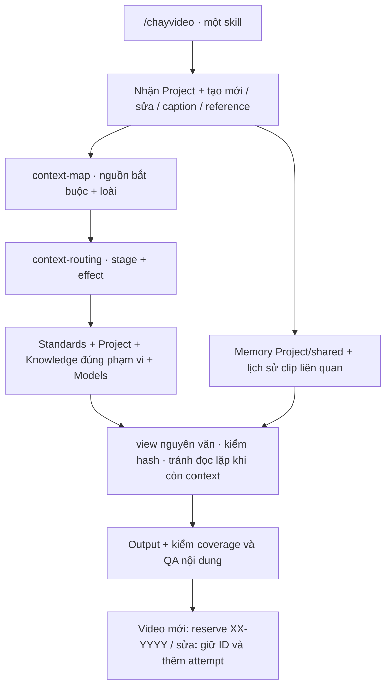

# Nature Studio v2.0.0

Ngày: 2026-10-17 | Bản nguồn local; không ngụ ý đã có Git tag/GitHub Release.

## Thay đổi

- Một skill /chayvideo, nhận nhánh tạo mới/sửa/caption/reference; nguồn chọn qua context-map và context-routing của Project, chỉnh độc lập với skill.
- Knowledge là thư viện dùng chung có phạm vi. Loài mới chọn đúng profile, Project mới chọn map riêng; không đọc toàn bộ thư viện hoặc dùng quy chuẩn Underwater cho deer.
- Đọc nguyên văn theo batch, tái dùng nguồn có hash chỉ khi còn toàn văn trong cùng context epoch; sau compaction đọc lại. Fullset đủ brief ưu tiên all + view một lần. Stage dùng khi giúp làm rõ/chọn hướng; không ép năm stage tăng overhead.
- Giữ source floor, fallback unknown/unassigned, phụ thuộc effect và coverage; không bật cắt đoạn hay nén Knowledge bằng AI. Memory tiếp tục truy xuất descriptor Project/shared từ v1.8.
- Mã mới **XX-YYYY**: hai chữ ASCII, bốn số 0001–9999. UF dành riêng cho legacy. Migrate namespace khi init/reserve thật, giữ UUID Project và toàn bộ mã/series/bộ đếm cũ; guard chống allocator v1.x ghi sai.
- VERSION dùng MAJOR.MINOR.PATCH; bản vá nhỏ tiếp theo 2.0.1, 2.0.2… helper `versioning.py check/next` và CI kiểm marker hiện hành.

## Cấu trúc

## Nâng cấp và giới hạn

Sao lưu registry, production, ledger, Memory và quota trước khi thay nguồn. Không gọi init/reserve để kiểm nâng cấp trên dữ liệu thật. Registry chưa chuyển vẫn dùng được để đọc; chỉ status là read-only. Xem [UPDATE](../UPDATE.md), [mã video](../00-Standards/video-identifiers.md), [phân luồng](../00-Standards/context-routing.md), [Knowledge](../00-Standards/knowledge-routing.md) và [phiên bản](../00-Standards/versioning.md).

Đề xuất đã qua ba vòng QA local trước triển khai: xung đột UF/legacy; migration/rollback/guard; concurrency, lỗi ghi file và source floor. Báo cáo kiểm hồi quy sau triển khai nằm trong audit local, không đưa runtime vào gói hệ thống.

Các đo token trước chốt v2.0.0 là proxy cho phần đọc nguồn, không phải tổng usage/hóa đơn; thay đổi tài liệu v2 có thể đổi số đo. Chưa có A/B chất lượng sáng tạo/model hoặc QA media mới. Kiểm coverage và giữ dữ kiện không chứng minh đầu ra luôn ngang hoặc tốt hơn ở mọi ca; các gate nội dung vẫn bắt buộc.
